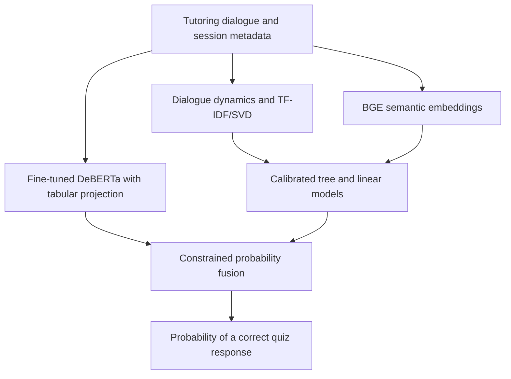

# Trace the Ace

### Predicting student quiz performance from tutoring conversations

A supervised machine learning and NLP project that combines tutoring dialogue, session metadata, transformer representations, and calibrated ensembles to estimate the probability of a correct assessment response.

**Final standing 183 of 530 ranked entries · Final private log loss 0.60791 · ROC AUC 0.60463**

Developed for DrivenData's Trace the Ace challenge, the project spans feature engineering, GPU model training, grouped validation, experiment analysis, and packaging for offline inference. Its recorded leaderboard log loss improved from **0.6450 to 0.6102**, a **5.4% relative reduction** across the documented submission experiments. The task is described in the [DrivenData reference solution](https://blog.drivendata.org/blog/productive-math-talk-reference), and the submission results are recorded in the [experiment log](docs/EXPERIMENT_LOG.md).

## The problem

Tutoring conversations contain evidence about how students reason, respond to guidance, and work through misconceptions. This project turns those interactions into features for predicting whether a student will answer a subsequent question correctly for a particular learning objective.

Each prediction combines the preceding dialogue with the available session and curriculum metadata. The output is a probability between zero and one. **Log loss** is the primary metric, so probability calibration matters alongside discrimination, measured with ROC AUC.

## How the pipeline works

The repository contains several experimental variants of this architecture. Their feature sets, prompts, encodings, and blend weights differ.

## Technical strengths

- **Domain-informed NLP features.** Measures student participation, mathematical vocabulary, tutor scaffolding, self-repair, causal reasoning, and changes in uncertainty across the dialogue. TF-IDF and truncated SVD add lexical representations. See the [pedagogical feature extractor](src/features/pedagogical.py).
- **Transformer and tabular modeling.** BGE embeddings capture semantic content. A custom DeBERTa-v3-Large classifier combines pooled text representations with a tabular projection. Training includes mixed precision, gradient checkpointing, and layer-wise learning rate decay. See the [embedding extractor](src/features/transformer_embeddings.py) and [DeBERTa training code](kaggle_kernel/train_deberta.py).
- **Ensemble design and calibration.** Combines LightGBM, CatBoost, XGBoost, histogram gradient boosting, and calibrated Ridge models. Experiments use three seeds and five folds, sigmoid calibration, constrained blending, temperature scaling, and probability clipping. See the [ensemble training code](src/models/train_exp15_ensemble.py).
- **Validation and error analysis.** Uses grouped folds to separate sessions or students. EXP-15 computes Bayesian and target encodings inside the outer training folds. Experiment notes investigate negative stacking weights, prompt mismatches, and calibration changes. See the [validation code](src/validation.py), [Bayesian encoder](src/features/hierarchical_bayes.py), and [findings](findings.md).
- **Inference engineering.** Includes submission builders, a local evaluation harness, and package checks for offline execution, model assets, output format, and finite predictions. See the [package builder](src/package_exp15_submission.py) and [submission auditor](src/audit_submission_package.py).

## Recorded results

The finalized competition reports **1,150 registered participants**. Its leaderboard contains **530 ranked entries**. These counts describe registration and scored entries respectively. Verified on November 12, 2026 against the [official competition](https://platform.k12-ai-infrastructure.org/competitions/3/tutoring-outcomes/) and [final leaderboard](https://platform.k12-ai-infrastructure.org/competitions/3/tutoring-outcomes/leaderboard/).

| Final private evaluation | Rank | Log loss ↓ | ROC AUC ↑ |
| --- | --- | --- | --- |
| This project | **183 / 530** | **0.60791** | **0.60463** |
| First-place entry | 1 / 530 | 0.59233 | 0.65088 |

The absolute log-loss gap to first place is **0.01558**, or **2.63%** relative to the first-place loss.

Earlier leaderboard records show the progression across submission experiments.

| Submission | Evaluation | Log loss ↓ | ROC AUC ↑ |
| --- | --- | --- | --- |
| EXP-1 baseline | Competition leaderboard | 0.6450 | 0.5420 |
| EXP-10 ensemble | Competition leaderboard | **0.6102** | **0.6092** |

These are historical results recorded in the project log. Local cross-validation and platform smoke tests are documented separately, with their evaluation context, in the [full experiment history](docs/EXPERIMENT_LOG.md).

The recorded EXP-16 local score used full-data target encodings, which can make validation optimistic. Group separation alone does not establish that the entire feature and calibration pipeline is free from leakage. EXP-15 implements encodings within the outer folds, while its blend weights are selected on out-of-fold predictions. An independent holdout is needed to assess the complete model-selection procedure.

## Technology

**Python · PyTorch · Hugging Face Transformers · scikit-learn · LightGBM · CatBoost · XGBoost · NumPy · pandas · SciPy · Kaggle GPU workflows**

## Explore the repository

| Path | Contents |
| --- | --- |
| [`src/features/`](src/features/) | Dialogue features, transformer embeddings, and difficulty encodings |
| [`src/models/`](src/models/) | Training, ensembling, and calibration |
| [`kaggle_kernel/`](kaggle_kernel/) | GPU training and embedding extraction entry points |
| [`src/kaggle/`](src/kaggle/) | Standalone Kaggle scripts and output helpers |
| [`src/evaluate_local_harness.py`](src/evaluate_local_harness.py) | Local evaluation of packaged inference |
| [`docs/EXPERIMENT_LOG.md`](docs/EXPERIMENT_LOG.md) | Historical benchmarks and submission records |
| [`docs/plans/`](docs/plans/) | Experiment and implementation plans |

The [challenge brief](challenge.md) explains the competition context. The [task plan](task_plan.md) and [progress log](progress.md) track development and maintenance.

## Data access and reproduction

This repository provides the source and experiment documentation. Reproduction requires separately obtained competition data, compatible dependencies, and the corresponding fitted model assets. The available EXP-15 trainer and local EXP-16 artifact represent different configurations, so the source snapshot alone cannot reproduce the recorded EXP-16 result.

Run local scripts from the repository root and use the documented Kaggle runtime for the GPU entry points. For Kaggle download and log helpers, set `TRACE_ACE_KAGGLE_KERNEL` locally in `owner/kernel` form and configure authentication through the local credential store or environment. Follow the [single-archive rule](AGENTS.md) when selecting a submission builder.

Datasets, transcripts, derived row-level outputs, checkpoints, submission archives, logs, credentials, and device-specific configuration stay local under the [ignore rules](.gitignore). Account references are supplied through local configuration.

## License

Original project code is available under the [MIT License](LICENSE). Third-party libraries, pretrained models, and competition datasets retain their respective licenses and terms of use.
