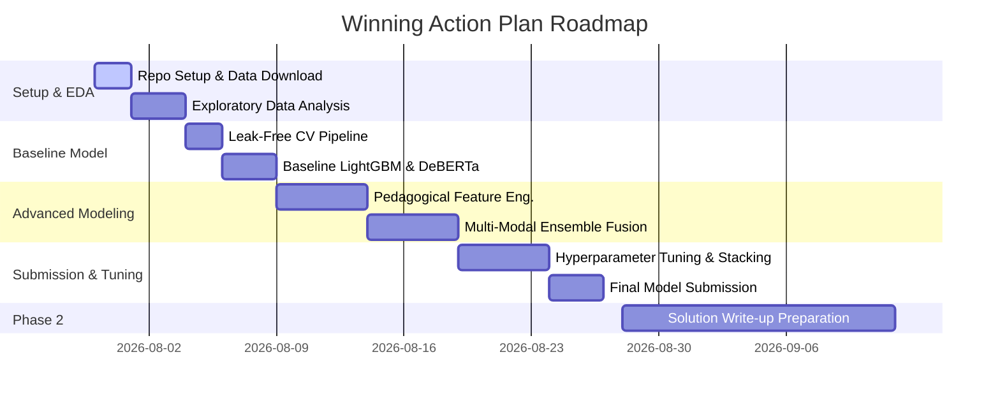

# 🏆 Challenge Briefing & Winning Strategy: Trace the Ace

> Repository privacy (2026-11-12). Keep competition datasets, derived row-level outputs, fitted assets, credentials, private account references, and device-specific configuration in ignored local files.

> **Role**: Lead Developer & AI Systems Partner  
> **Target Competition**: Trace the Ace – Tutoring Outcomes Prediction Challenge  
> **Platform**: K-12 AI Infrastructure Program (Digital Promise & DrivenData)  
> **Host**: National Tutoring Observatory (NTO)  
> **Prize Pool**: $50,000 USD  

> Workspace note (2026-11-06). This brief preserves the competition-era strategy. The repository separates code and documentation from local competition data, derived files, and submission artifacts. See the [workspace map](README.md) for file locations.

---

## 1. Executive Summary & Competition Overview

**Trace the Ace** is a machine learning competition focused on evaluating the efficacy of K-12 educational tutoring sessions using **only student–tutor conversation transcripts** and session metadata. The objective is to build predictive models that accurately forecast student learning gains—proxied by post-session quiz performance—based on session back-and-forth interactions.

### Key Metrics & Prizes
* **Total Prize Purse**: $50,000 USD
  * 🥇 **1st Place**: $15,000
  * 🥈 **2nd Place**: $10,000
  * 🥉 **3rd Place**: $7,000
  * 📝 **Publication Bonus**: $2,000 each (awarded to up to 9 top solution write-ups)
* **Key Dates**:
  * **Model Submission Window Ends**: August 27, 2026 (11:59 PM UTC)
  * **Leaderboard Freeze**: August 27, 2026
  * **Solution Write-up Deadline (Top 15 Teams)**: September 15, 2026 (11:59 PM UTC)

---

## 2. Problem Formulation & Data Architecture

### Core Predictive Task
Given a tutoring session consisting of:
1. **Dialogue Transcripts**: Human student–tutor interaction text (utterances, turn taking, questions, explanations).
2. **Tabular Metadata**: Session properties, topic/subject identifiers, timing metrics, and prior performance metrics.

**Target Variable**: Binary classification (Quiz Correctness: `0` or `1`) or continuous proxy score representing learning gains directly after the session.

```
       ┌────────────────────────┐      ┌────────────────────────┐
       │   Student-Tutor Text   │      │    Session Metadata    │
       │  Dialogue Transcripts  │      │  (Tabular Features)    │
       └───────────┬────────────┘      └───────────┬────────────┘
                   │                               │
                   ▼                               ▼
       ┌────────────────────────┐      ┌────────────────────────┐
       │  LLM / Text Encoders   │      │ Feature Engineering    │
       │ (DeBERTa, Llama-3, etc)│      │  (Ratios, Dynamics)    │
       └───────────┬────────────┘      └───────────┬────────────┘
                   │                               │
                   └───────────────┬───────────────┘
                                   │
                                   ▼
                       ┌──────────────────────┐
                       │  Multi-Modal Fusion  │
                       │ GBDT + Stacking Ensemble
                       └───────────┬──────────┘
                                   │
                                   ▼
                       ┌──────────────────────┐
                       │ Learning Gain Score  │
                       │   (Quiz Prediction)  │
                       └──────────────────────┘
```

---

## 3. Domain Insights & Strategic Hypotheses

Effective tutoring is defined by **pedagogical interaction quality** rather than simple text length. Key indicators to engineer and model include:

### A. Pedagogical Dynamics & Dialogue Ratios
* **Student Speech Ratio**: Tutors who talk too much often reduce active student learning. Higher student response ratio correlates with active cognitive engagement.
* **Scaffolding & Prompting**: Identifying whether tutors give direct answers vs. Socratic open-ended questions that prompt student reflection.
* **Misconception Resolution**: Tracking shift in student response correctness or confidence from early turns to late turns in the transcript.

### B. NLP Representation Strategy
1. **Dialogue-Aware Encoders**: Fine-tune `DeBERTa-v3-large` or `ModernBERT` with role tags (`[TUTOR]: ... [STUDENT]: ...`) to capture conversational flow.
2. **Turn-Level Sentiment & Confidence Tracking**: Extract sentiment/frustration/confidence vectors per turn to model emotional and cognitive arcs across the session.
3. **LLM Feature Extraction**: Prompt long-context LLMs (e.g. Llama-3.1-70B / Qwen-2.5) to extract structured pedagogical scores (e.g. clarity, student engagement, feedback constructiveness).

### C. Tabular Feature Engineering & GBDT Modeling
* **Temporal Dynamics**: Turn latency, total transcript duration, utterance length velocity.
* **Gradient Boosted Trees**: LightGBM, XGBoost, and CatBoost trained on aggregated textual features, domain heuristics, and LLM embeddings.

---

## 4. Validation & Cross-Validation Strategy

To avoid data leakage and over-fitting to specific tutors or students:
* **GroupKFold by Student / Tutor ID**: Ensure no student or tutor spans both train and validation splits.
* **Metric Alignment**: Optimize strictly against log-loss / AUC / RMSE (matching competition evaluation metric).
* **Leak-Free Pipeline**: Perform all text vectorizations, scaling, and feature extractions strictly inside CV folds.

---

## 5. Winning Action Plan & Development Roadmap



### Immediate Next Steps
1. **Set Up Data & Pipeline Environment**: Download dataset, set up structured workspace and baseline notebook/scripts.
2. **Build Baseline Pipeline**: Establish a strict 5-Fold GroupKFold CV framework.
3. **Iterative Feature & Model Benchmark**: Train GBDT baselines and DeBERTa text models, benchmark CV score improvements systematically.
